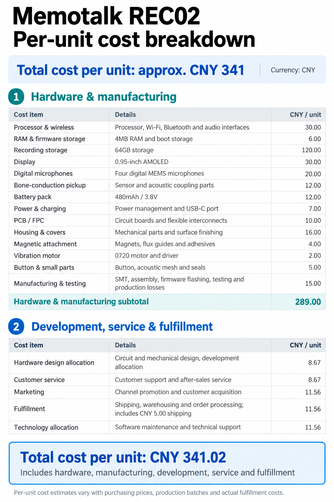

# Memotalk REC02 per-unit cost breakdown

[简体中文](REC02-COST.zh-CN.md)

**Total cost per unit: approx. CNY 341.** All amounts are in Chinese yuan per unit.

## Hardware & manufacturing

| Cost item | Details | CNY / unit |
| :-- | :-- | --: |
| Processor & wireless | Processor, Wi-Fi, Bluetooth and audio interfaces | 30.00 |
| RAM & firmware storage | 4MB RAM and boot storage | 6.00 |
| Recording storage | 64GB storage | 120.00 |
| Display | 0.95-inch AMOLED | 30.00 |
| Digital microphones | Four digital MEMS microphones | 20.00 |
| Bone-conduction pickup | Sensor and acoustic coupling parts | 12.00 |
| Battery pack | 480mAh / 3.8V | 12.00 |
| Power & charging | Power management and USB-C port | 7.00 |
| PCB / FPC | Circuit boards and flexible interconnects | 10.00 |
| Housing & covers | Mechanical parts and surface finishing | 16.00 |
| Magnetic attachment | Magnets, flux guides and adhesives | 4.00 |
| Vibration motor | 0720 motor and driver | 2.00 |
| Button & small parts | Button, acoustic mesh and seals | 5.00 |
| Manufacturing & testing | SMT, assembly, firmware flashing, testing and production losses | 15.00 |
| **Hardware & manufacturing subtotal** | | **289.00** |

## Development, service & fulfillment

| Cost item | Details | CNY / unit |
| :-- | :-- | --: |
| Hardware design allocation | Circuit and mechanical design, development allocation | 8.67 |
| Customer service | Customer support and after-sales service | 8.67 |
| Marketing | Channel promotion and customer acquisition | 11.56 |
| Fulfillment | Shipping, warehousing and order processing; includes CNY 5.00 shipping | 11.56 |
| Technology allocation | Software maintenance and technical support | 11.56 |
| **Total cost per unit** | **Includes hardware, manufacturing, development, service and fulfillment** | **341.02** |

Per-unit cost estimates vary with purchasing prices, production batches and actual fulfillment costs.
