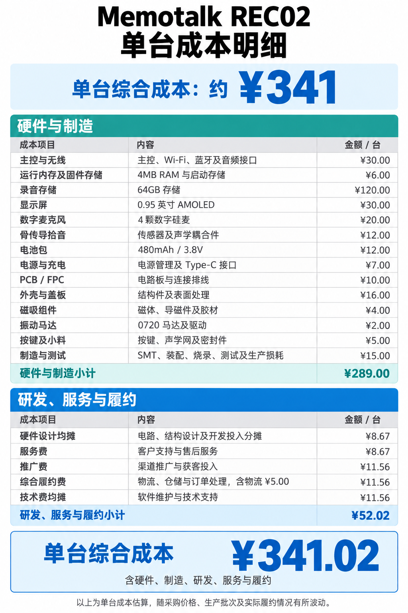

# Memotalk REC02 单台成本明细

[English](REC02-COST.md)

**单台综合成本：约 ¥341。** 金额单位：人民币元/台。

## 硬件与制造

| 成本项目 | 内容 | 金额 / 台 |
| :-- | :-- | --: |
| 主控与无线 | 主控、Wi-Fi、蓝牙及音频接口 | ¥30.00 |
| 运行内存及固件存储 | 4MB RAM 与启动存储 | ¥6.00 |
| 录音存储 | 64GB 存储 | ¥120.00 |
| 显示屏 | 0.95 英寸 AMOLED | ¥30.00 |
| 数字麦克风 | 4 颗数字硅麦 | ¥20.00 |
| 骨传导拾音 | 传感器及声学耦合件 | ¥12.00 |
| 电池包 | 480mAh / 3.8V | ¥12.00 |
| 电源与充电 | 电源管理及 Type-C 接口 | ¥7.00 |
| PCB / FPC | 电路板与连接排线 | ¥10.00 |
| 外壳与盖板 | 结构件及表面处理 | ¥16.00 |
| 磁吸组件 | 磁体、导磁件及胶材 | ¥4.00 |
| 振动马达 | 0720 马达及驱动 | ¥2.00 |
| 按键及小料 | 按键、声学网及密封件 | ¥5.00 |
| 制造与测试 | SMT、装配、烧录、测试及生产损耗 | ¥15.00 |
| **硬件与制造小计** | | **¥289.00** |

## 研发、服务与履约

| 成本项目 | 内容 | 金额 / 台 |
| :-- | :-- | --: |
| 硬件设计均摊 | 电路、结构设计及开发投入分摊 | ¥8.67 |
| 服务费 | 客户支持与售后服务 | ¥8.67 |
| 推广费 | 渠道推广与获客投入 | ¥11.56 |
| 综合履约费 | 物流、仓储与订单处理，含物流 ¥5.00 | ¥11.56 |
| 技术费均摊 | 软件维护与技术支持 | ¥11.56 |
| **单台综合成本** | **含硬件、制造、研发、服务与履约** | **¥341.02** |

以上为单台成本估算，随采购价格、生产批次及实际履约情况有所波动。
